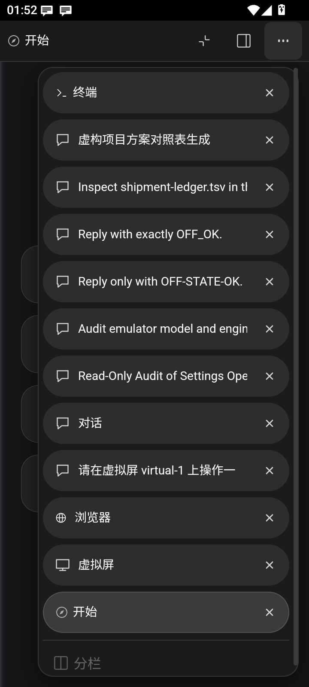
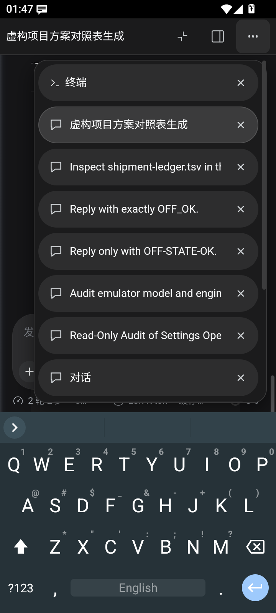
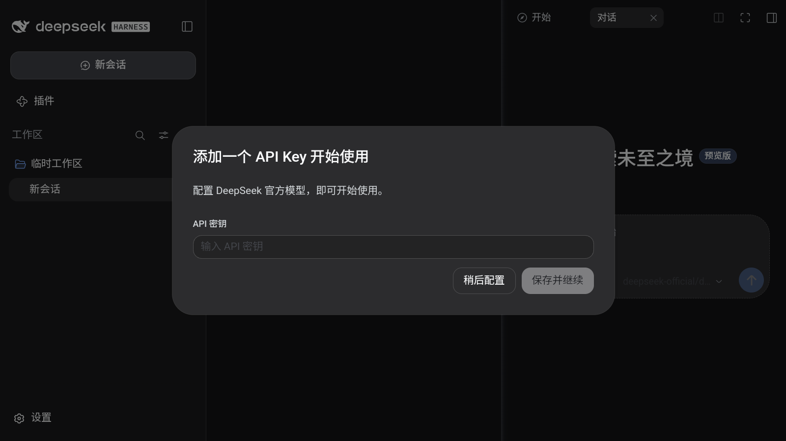
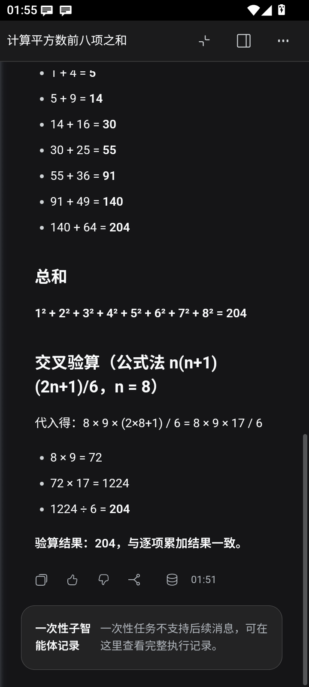

# 右侧多任务气泡导航验收（2026-10-17）

窄窗口使用当前面板标题和右上角三点按钮。展开后沿原顺序列出胶囊标签；点击选择后收起，普通纵向滑动滚动列表，长按 400ms 后在原分栏内排序。窗口达到 768 CSS 像素时恢复原横向标签与主副面板并排。不改版本号，不发布。

## 实现与生命周期

新增导航仅复制原标签的显示元数据，并代理原选择、关闭及窗口控制动作。原内容节点、会话、终端、浏览器和虚拟屏继续由原提供方管理。排序适配 B1 在 SidebarRight 所属 store 上调用原 placeTab/focusTab，保留活动页，拒绝失效会话、浮动页、跨分栏和无变化目标。

原生 BrowserHost 在气泡 open/closing 期间仅隐藏显示层，退出动画完成后恢复原页面。面板尺寸、visualViewport、系统安全区及原生 IME inset 共同限制列表边界。原 strip 重建时按元素身份更新代理；取消长按后首次 Android 返回有效，并恢复触发按钮焦点。

## 代码层

- UI 源码 PR：[dsh-client-ui-responsive #43](https://github.com/kelai141/dsh-client-ui-responsive/pull/43)，提交 f963996。
- npm run build 通过；npm test 共 51 个测试文件通过，762 项通过、1 项既有跳过。气泡测试 20 项，覆盖切换、关闭、节点重建、键盘、返回、拖拽取消、多标签及 IME。
- B1 的 7 项测试覆盖真实 npm 包、Android 源码构建、幂等、活动页保留、失效目标，以及实际 runner 对损坏输入拒绝写入。
- Linux 下 check-patch-test-manifest：30 个文件，62 项通过、0 失败。Windows 门禁声明的两条既有 symlink EPERM 不作为产品结果。
- 执行地图、夹具身份和补丁自洽门禁通过。本轮补丁目录与 check-patch-mirror.mjs 保持双仓逐字节一致；协调仓同步了 APK main 已有的两条补丁测试修正。

## CDP 与 ADB 用户层

开发验收采用现有测试 APK 的运行时热推，未重打包 APK。两台设备均确认 snapshot fingerprint 在场、snapshot transaction 不在场；更新插件和 B1 后重启现有应用，再为每次验收发现当前 WebView target。

| 设备 | 实测窗口 | 结果 |
|---|---|---|
| emulator-5556，Android 15，测试 APK 0.14.7-management-ui | 360 × 800 CSS px | 12 个真实标签；11 项 CDP + ADB 验收通过 |
| emulator-5562，测试 APK 保持原安装 | 1067 × 600 CSS px | 原生横向标签和并排会话通过 |

竖屏覆盖原生点击选择并收起、返回优先级、外部点击屏蔽、纵向滚动、长按拖动换序、取消后首次返回及焦点恢复、四类面板切换的 tab/content 身份保留、连续开关、关闭侧开标签后原会话仍在，以及切页重建后的收起/重开按钮。

软键盘采用临时离线 HeliBoard：页面及 visualViewport 均保持 800px，原生 IME 高度 262px；列表底部 526px，键盘顶部 538px，保留 12px 间距。已恢复原输入法及硬键盘显示设置，临时键盘卸载。

真实任务仅给出并行校验目标，由 MiMo 2.5 自主分工并创建一次性子代理。主会话求斐波那契前八项之和 54，子代理求平方数之和 204，并汇总差值 150。随后 ADB 长按子代理目录行并拖入右侧开区；主会话 owner 保持不变，右侧显示同一子代理的完整历史与一次性只读提示。

## 产物身份及边界

UI 源码构建、APK 镜像和两台设备的 lib/client.js SHA256 均为 30eddb2b94a9c4af5f9d3adf2cd4540646dcf107defa3e8b642b8be977681774。两台设备 B1 后的右栏 client.js SHA256 均为 3fed65aac96b43f7cafe811a7be02737b68687a67e9514c2d989ea9d2caf27fc。

浏览器页在该模拟器报告 browser-profile-unsupported，故本轮实际验证了原标签身份与失败提示保留；原生浏览器可用 profile 内的页面交互由现有适配器与显示层单测覆盖，未记作该设备的成功导航。未做 arm64 真机验证，未构建发版候选。

全仓跨仓镜像检查仍报告本轮之前 main 间的构建脚本、Linux 环境和台账差异。本次保留它们的原归属，不以补丁目录一致冒充全仓一致。发布链应在进入候选前完成全仓对账。

设备驱动为 scripts/verify-sidebar-bubbles.mjs；完整本地命令及截图保存在协调工作区 .deploy-tmp/bubble-tabs-20261017/。本目录附竖屏、横屏、键盘和真实子代理的结果读回，便于独立审查。
